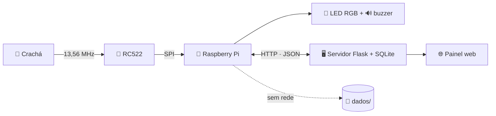
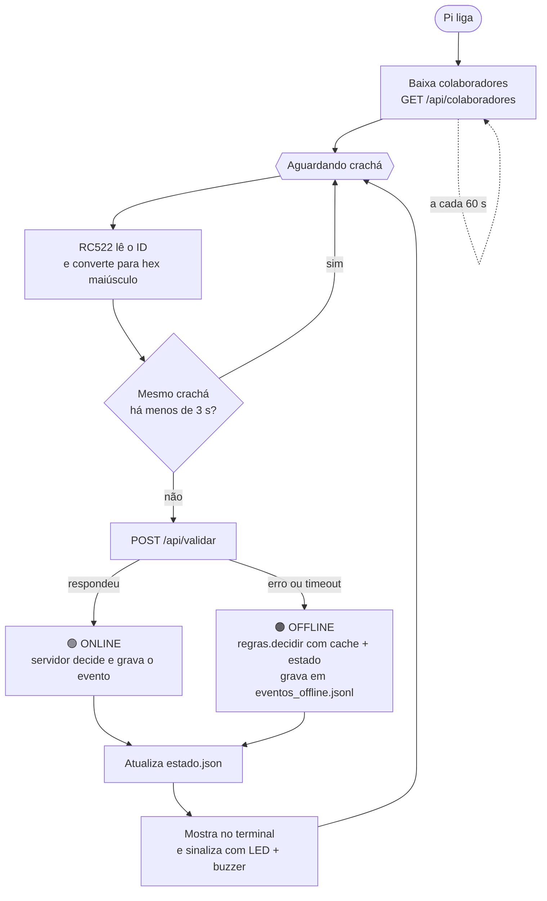

# 🔐 Controle de Acesso RFID — Raspberry Pi

> A parte embarcada do sistema de controle de acesso da **Sala Restrita AAA**.
> A Raspberry Pi lê o crachá, pergunta ao servidor se a pessoa pode entrar e responde na hora com LED e buzzer.
> **Se a rede cair, ela decide sozinha.**


Projeto final de **Hardware Architecture — Atitus**. O servidor Flask, o banco e o painel web ficam no repositório do backend: [gabhmm/projeto-raspi-rfid](https://github.com/gabhmm/projeto-raspi-rfid).

---

## Sumário

- [Destaques](#-destaques)
- [Como funciona](#-como-funciona)
- [Hardware e ligações](#-hardware-e-ligações)
- [Instalação](#-instalação)
- [Uso](#️-uso)
- [Modo offline por dentro](#-modo-offline-por-dentro)
- [Contrato com o backend](#-contrato-com-o-backend)
- [Estrutura do código](#-estrutura-do-código)
- [Solução de problemas](#-solução-de-problemas)
- [Limitações e próximos passos](#-limitações-e-próximos-passos)
- [Equipe](#-equipe)

---

## ✨ Destaques

- **Online e offline.** Com rede, o servidor decide e grava o evento. Sem rede (erro ou mais de 3 s sem resposta), a Pi usa o cache local de colaboradores e decide sozinha.
- **A mesma regra nos dois lados.** [comum/regras.py](comum/regras.py) segue a mesma lógica do servidor, então a decisão offline é igual à que o servidor tomaria.
- **Sabe quem está na sala.** O `estado.json` guarda quem está dentro e quem já entrou hoje. É atualizado em toda leitura, online ou offline, e zera quando o dia muda.
- **Não corrompe se a Pi desligar.** Os JSON são gravados num arquivo `.tmp` e trocados com `os.replace`, que é atômico.
- **Sem leituras duplicadas.** O mesmo crachá é ignorado por 3 s. Deixar o crachá parado no leitor também não repete a leitura.
- **Resposta na hora.** Cada resultado tem cor e som próprios.

---

## 🧭 Como funciona

### Visão geral



### Fluxo de uma leitura



### Regras de acesso

As regras são testadas nesta ordem, e a primeira que bater define o resultado:

| # | Situação | Resultado | Mensagem |
| :-: | --- | --- | --- |
| 1 | Tag não cadastrada | `INVASAO` | Acesso negado, tag não cadastrada |
| 2 | Está dentro da sala | `SAIDA` | Até logo, {nome} |
| 3 | Inativo ou sem `acesso_sala` | `NEGADO` | Acesso negado, {nome} |
| 4 | Já entrou hoje | `ENTRADA` | Bem-vindo de volta, {nome} |
| 5 | Primeira entrada do dia | `ENTRADA` | Bem-vindo, {nome} |

> [!NOTE]
> A saída vem **antes** da checagem de permissão de propósito. Se alguém perde o acesso enquanto está na sala, ainda consegue sair.

### Sinalização

| Resultado | Buzzer | LED |
| --- | --- | --- |
| `ENTRADA` | 1 bip curto | 🟢 Verde por 2 s |
| `SAIDA` | 2 bips curtos | 🟡 Amarelo por 2 s |
| `NEGADO` | 1 bip longo | 🟡 Amarelo por 2 s |
| `INVASAO` | 3 bips curtos | 🔴 Vermelho piscando 3× |

O buzzer pode ser desligado com `BUZZER_ATIVO = False` em [pi/config.py](pi/config.py).

---

## 🔧 Hardware e ligações

### Componentes

- Raspberry Pi com Raspberry Pi OS
- Leitor RFID **RC522** + crachás ou tags **13,56 MHz** (MIFARE)
- LED RGB (cátodo ou ânodo comum) + **3 resistores de 220 Ω**, um por cor
- Buzzer **ativo**
- Protoboard e jumpers

> [!WARNING]
> O RC522 funciona em **3.3 V**. Ligar no 5 V pode queimar o módulo.

### Leitor RC522 (SPI)

| RC522 | Pino físico da Pi | Função |
| --- | :-: | --- |
| SDA | 24 | CE0 (chip select) |
| SCK | 23 | clock SPI |
| MOSI | 19 | dados Pi → leitor |
| MISO | 21 | dados leitor → Pi |
| IRQ | — | não usado |
| GND | 6 | terra |
| RST | 22 | reset |
| 3.3V | 1 | alimentação |

### LED RGB e buzzer

| Componente | GPIO (BCM) | Pino físico |
| --- | :-: | :-: |
| LED vermelho | 17 | 11 |
| LED verde | 27 | 13 |
| LED azul | 22 | 15 |
| LED comum, **cátodo** | — | 9 (GND) |
| LED comum, **ânodo** | — | 17 (3.3V) |
| Buzzer + | 18 | 12 |
| Buzzer − | — | 14 (GND) |

> [!IMPORTANT]
> O código usa a numeração **GPIO (BCM)**, e as tabelas de ligação usam o **pino físico**. GPIO22 (LED azul) fica no pino físico 15. O pino físico 22 é o RST do RC522.

### Mapa do header (pinos usados)

```text
                      ┌───────┐
  RC522 3.3V     ●  1 │       │ 2  ○
                 ○  3 │       │ 4  ○
                 ○  5 │       │ 6  ●  RC522 GND
                 ○  7 │       │ 8  ○
  LED comum ¹    ●  9 │       │ 10 ○
  LED vermelho   ● 11 │       │ 12 ●  Buzzer +
  LED verde      ● 13 │       │ 14 ●  Buzzer −
  LED azul       ● 15 │       │ 16 ○
  LED comum ¹    ● 17 │       │ 18 ○
  RC522 MOSI     ● 19 │       │ 20 ○
  RC522 MISO     ● 21 │       │ 22 ●  RC522 RST
  RC522 SCK      ● 23 │       │ 24 ●  RC522 SDA
                 ○ 25 │       │ 26 ○
                      └───────┘
  ¹ Só um dos dois: pino 9 (GND) para cátodo comum, pino 17 (3.3V) para ânodo comum.
```

> [!TIP]
> Rode `pinout` no terminal da Pi para ver o header do seu modelo. O pino 1 fica na ponta oposta às portas USB.

---

## 🚀 Instalação

### 1. Habilitar o SPI

```bash
sudo raspi-config nonint do_spi 0     # ou: sudo raspi-config → Interface Options → SPI → Yes
sudo reboot
ls /dev/spidev*                       # deve aparecer /dev/spidev0.0
```

### 2. Clonar e preparar o ambiente

```bash
git clone https://github.com/codBrayan/rasp-rfid.git
cd rasp-rfid

python3 -m venv --system-site-packages venv
source venv/bin/activate
pip install mfrc522 requests
```

`--system-site-packages` deixa o venv usar o `gpiozero` e o `RPi.GPIO` que já vêm no Raspberry Pi OS, então não é preciso compilar nada.

### 3. Configurar

Tudo fica em [pi/config.py](pi/config.py). O que você precisa mudar é o **`SERVIDOR_URL`**, com o IP da máquina onde o backend está rodando.

| Constante | Padrão | O que faz |
| --- | --- | --- |
| `SERVIDOR_URL` | `http://192.168.0.10:5000` | Endereço do backend Flask |
| `TIMEOUT_SEGUNDOS` | `3` | Quanto tempo esperar o servidor antes de passar para o modo offline |
| `INTERVALO_CACHE_SEGUNDOS` | `60` | De quanto em quanto tempo o `cache.json` é atualizado |
| `DEBOUNCE_SEGUNDOS` | `3` | Por quanto tempo o mesmo crachá é ignorado |
| `PINO_LED_VERMELHO` · `VERDE` · `AZUL` | `17` · `27` · `22` | GPIOs (BCM) do LED RGB |
| `LED_ANODO_COMUM` | `False` | `True` se a perna comum do LED vai no 3.3V |
| `PINO_BUZZER` | `18` | GPIO (BCM) do buzzer |
| `BUZZER_ATIVO` | `True` | `False` deixa o buzzer em silêncio |
| `PASTA_DADOS` | `dados` | Onde ficam cache, estado e eventos offline |

---

## ▶️ Uso

Sempre **da raiz do repositório**, com o venv ativo:

```bash
python -m pi.main
```

```text
[CACHE] 12 colaboradores carregados
Aguardando crachá...
[ONLINE] A1B2C3D4 ENTRADA: Bem-vindo, Ana
[ONLINE] A1B2C3D4 SAIDA: Até logo, Ana
[OFFLINE] 9F8E7D6C NEGADO: Acesso negado, Bruno
[OFFLINE] 11223344 INVASAO: Acesso negado, tag não cadastrada
```

`Ctrl+C` encerra e libera os GPIOs.

### Testar cada parte separadamente

| Comando | O que testa |
| --- | --- |
| `python -m pi.leitor` | Mostra o UID de cada crachá aproximado. Use para descobrir a `tag_uid` na hora de cadastrar alguém no painel. |
| `python -m pi.atuadores` | Mostra as 4 sinalizações em sequência: ENTRADA, SAIDA, NEGADO, INVASAO. |
| `curl http://<IP>:5000/api/colaboradores` | Confere se a Pi alcança o servidor. |
| Parar o servidor ou tirar o cabo de rede | As leituras passam a aparecer como `[OFFLINE]`. |

---

## 📴 Modo offline por dentro

A Pi mantém três arquivos em `dados/`, criados automaticamente:

| Arquivo | Quem escreve | Para que serve |
| --- | --- | --- |
| `cache.json` | Ao ligar e a cada 60 s, se o servidor responder | Lista de colaboradores usada para decidir offline |
| `estado.json` | Em toda leitura, online ou offline | Quem está dentro e quem já entrou hoje |
| `eventos_offline.jsonl` | Só nas leituras offline | Registro do que aconteceu sem rede, uma linha por evento |

<details>
<summary>Exemplo de <code>estado.json</code></summary>

```json
{
  "data": "2026-10-28",
  "dentro": ["A1B2C3D4"],
  "entraram": ["A1B2C3D4", "9F8E7D6C"]
}
```

`dentro` decide se a próxima leitura é `SAIDA`. `entraram` decide entre "Bem-vindo" e "Bem-vindo de volta". Quando `data` deixa de ser hoje, as duas listas são zeradas.
</details>

<details>
<summary>Exemplo de <code>eventos_offline.jsonl</code></summary>

```json
{"data_hora": "2026-10-28T19:15:02", "tag_uid": "A1B2C3D4", "nome": "Ana", "resultado": "ENTRADA"}
{"data_hora": "2026-10-28T19:40:11", "tag_uid": "11223344", "nome": null, "resultado": "INVASAO"}
```
</details>

> [!NOTE]
> O modo offline depende de a Pi ter falado com o servidor **pelo menos uma vez**. Sem `cache.json`, todo crachá é tratado como não cadastrado (`INVASAO`).

---

## 🔌 Contrato com o backend

A API é aberta e usa JSON. A Pi usa só duas rotas:

**`POST /api/validar`**: o servidor decide o resultado e grava o evento.

```jsonc
// requisição
{ "tag_uid": "A1B2C3D4" }
// resposta 200
{ "resultado": "ENTRADA", "mensagem": "Bem-vindo, Ana" }
```

**`GET /api/colaboradores`**: lista salva no `cache.json`.

```json
[{ "id": 1, "nome": "Ana", "matricula": "01", "tag_uid": "A1B2C3D4", "cargo": "Artist", "acesso_sala": true, "ativo": true }]
```

`resultado` é sempre um destes: `ENTRADA` · `SAIDA` · `NEGADO` · `INVASAO`.

Uma permissão alterada no painel vale na hora enquanto a Pi está online. O contrato completo está no [repositório do backend](https://github.com/gabhmm/projeto-raspi-rfid).

---

## 📁 Estrutura do código

```text
rasp-rfid/
├── comum/
│   └── regras.py      # decidir(colaborador, esta_dentro, entrou_hoje) → (resultado, mensagem)
├── pi/
│   ├── config.py      # servidor, tempos e pinos
│   ├── leitor.py      # RC522 → tag_uid em hex maiúsculo
│   ├── atuadores.py   # sinalizar(resultado): LED RGB e buzzer
│   ├── api.py         # validar(tag) e buscar_colaboradores()
│   ├── offline.py     # cache, estado do dia e eventos offline
│   └── main.py        # loop: lê → valida (online/offline) → sinaliza
└── dados/             # criada em tempo de execução
```

Algumas decisões de design:

- **`main.py` não fala com o GPIO.** Ele só chama `leitor` e `atuadores`, então dá para trocar o hardware (por exemplo, ler a tag com `input()`) sem mexer no loop.
- **`comum/` fica fora de `pi/`.** A regra de acesso não depende da Pi, é a mesma do servidor.
- **O cache é atualizado numa thread separada.** O loop de leitura nunca fica esperando o download da lista.

---

## 🩺 Solução de problemas

| Sintoma | Causa provável | O que fazer |
| --- | --- | --- |
| Erro com `/dev/spidev0.0` | SPI desabilitado | Veja [Habilitar o SPI](#1-habilitar-o-spi) e reinicie |
| O leitor não lê nada | Fiação ou alimentação | Confira 3.3V, SDA (24) e RST (22). Aproxime o crachá a menos de ~3 cm |
| Alguns crachás não leem | Tag de 125 kHz | O RC522 só lê tags de **13,56 MHz** (MIFARE) |
| Sempre `[OFFLINE]` | Servidor inacessível | Confira `SERVIDOR_URL`, teste com `curl` e veja se o servidor aceita conexões da rede (no Windows, libere a porta 5000 no firewall) |
| Offline, todo crachá dá `INVASAO` | `cache.json` não existe | Ligue a Pi uma vez com o servidor no ar |
| LED aceso direto ou cores invertidas | Tipo de LED errado na config | Inverta `LED_ANODO_COMUM` |
| Buzzer só faz um clique | Buzzer passivo | Use um buzzer ativo ou desligue com `BUZZER_ATIVO = False` |
| `No module named 'pi'` | Rodou o arquivo direto | Rode da raiz com `python -m pi.main` |
| `No module named 'gpiozero'` | venv sem pacotes do sistema | Recrie com `--system-site-packages` |

---

## 🚧 Limitações e próximos passos

**Limitações conhecidas (v1)**

- Os eventos offline ficam só no arquivo local e não são enviados ao servidor.
- Se a rede cair logo depois de uma permissão ser revogada, a permissão antiga ainda pode valer por até `INTERVALO_CACHE_SEGUNDOS`.
- Há um leitor só, então entrada e saída são deduzidas pela ordem das leituras.
- A API não tem autenticação.

**Ideias para a v2**

- [ ] Enviar `eventos_offline.jsonl` ao servidor quando a rede voltar, com um `event_id` para não duplicar
- [ ] Autenticar a Pi na API
- [ ] Usar dois leitores, um para entrada e outro para saída
- [ ] Rodar como serviço `systemd` para iniciar junto com a Pi

---

## 👥 Equipe

| Integrante | Responsabilidade |
| --- | --- |
| **Brayan Lima** | Sistema embarcado (RFID, atuadores e cache offline) e documentação |
| Gabriel M. Magalhães | Backend Flask, SQLite e API REST |
| Guilherme Matte Embarach | Backend Flask, SQLite e API REST |
| Pedro Arthur Silvestri | Front-end web (gerenciamento e monitoramento) |
| Adriano Cesar | Análise de dados com Pandas |

<p align="center"><sub>Hardware Architecture · Atitus · 2026</sub></p>
